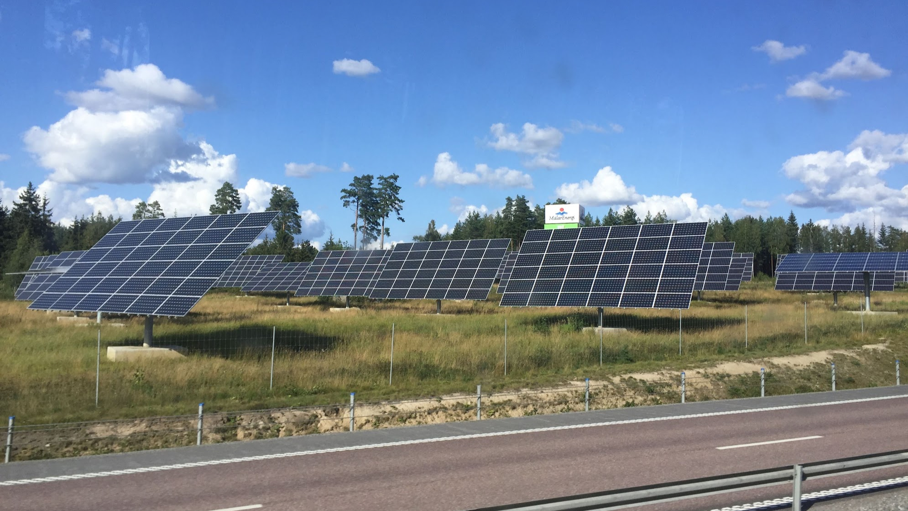

<!--This is my personal clarity, please delete or replace with your own clarity-->


Publication detail  
Journal: Nexus  
Article: Health and climate benefits of solar photovoltaics in Europe and the role of imports  
DOI: <https://doi.org/10.1016/j.ynexs.2026.100177>   
Publication date: October 29, 2026  
Links: Published [paper](https://doi.org/10.1016/j.ynexs.2026.100177); Open-access [pdf](https://www.cell.com/nexus/pdf/S2950-1601(26)00060-4.pdf); Source [Code and Data](https://zenodo.org/records/23480950)   

## Main Authors

:::{#main-authors}
:::

## Coauthors

:::{#coauthors}
:::

## Release

As world leaders prepare to gather for the 31st United Nations Climate Change Conference (COP31), a new [study](ttps://doi.org/10.1016/j.ynexs.2026.100177) offers a timely reminder that the benefits of clean energy extend far beyond reducing carbon emissions—and that international trade can play an important role in delivering those benefits.

The study, accepted for publication in the scientific journal *Nexus*, finds that solar photovoltaic (PV) electricity generation helped prevent more than 13,000 premature deaths and avoided nearly 47 million tonnes of carbon dioxide emissions across eight European countries between 2015 and 2021.

Together, these health and climate benefits were valued at $116.2 billion, with more than 99% attributed to improved air quality under the study's valuation approach.

The research also highlights an often-overlooked dimension of Europe's clean energy transition: the role of international solar supply chains. Using country-specific trade data, the researchers estimate that approximately $46.9 billion, or 40%, of the total benefits were associated with imported solar panels.

The findings offer new evidence for policymakers weighing the benefits of global clean energy trade and supply chains.

**Cleaner electricity, healthier communities**

The research team, led by scientists affiliated with Baruch College of the City University of New York and collaborating institutions, examined solar deployment in Belgium, France, Germany, Greece, Italy, the Netherlands, Spain, and the United Kingdom.

The researchers combined detailed electricity generation data, statistical analysis, atmospheric modeling, health impact assessment, and international trade statistics to examine how solar generation displaced electricity generation from fossil fuels and reduced air pollution.

Between 2015 and 2021, solar electricity generation displaced an estimated 418 terawatt-hours of fossil fuel generation across the eight countries.

This displacement reduced emissions of carbon dioxide and harmful air pollutants, including sulfur oxides, nitrogen oxides, and fine particulate matter.

Using atmospheric simulations and established health impact methods, the team estimated that these improvements prevented 13,025 premature deaths over the study period.

Germany accounted for the largest share of the benefits, with approximately 9,900 avoided premature deaths and $90.4 billion in monetized health and climate benefits.

One of the study's most striking findings is the economic importance of cleaner air. While solar generation’s contribution to reducing carbon emissions is widely recognized, the researchers found that improved air quality accounted for 99.2% of the estimated monetized benefits when climate benefits were valued using European carbon market prices.

**The hidden benefits of global solar trade**

Europe has increasingly sought to strengthen domestic solar manufacturing to support industrial competitiveness, energy security, and supply chain resilience.
At the same time, its rapid solar expansion has relied heavily on international supply chains.

To investigate this relationship, the researchers estimated how much of the environmental and health benefits of solar deployment could be associated with imported PV panels.
They found that imported solar panels were associated with approximately 40% of the benefits, equivalent to 20 million tonnes of avoided CO₂ emissions and 5,262 avoided premature deaths, corresponding to approximately $46.9 billion in monetized benefits.

The analysis uses national net import data and installed solar capacity additions to estimate import-associated shares. It does not directly track individual imported panels or establish that specific imports caused those benefits.

“Solar energy is not just a climate solution. It is also a public health investment. Our findings show that cleaner electricity has helped prevent thousands of premature deaths across Europe, generating benefits that go far beyond carbon reductions.” Said Kaifang Luo, a postdoctoral researcher at Baruch College and a lead author of the study.

The findings nevertheless underscore the importance of international supply chains in the history of Europe's solar expansion.

**Solar benefits do not stop at national borders**

The study also shows that solar deployment can improve environmental conditions beyond the countries where panels are installed.

“One important finding is that solar deployment can benefit communities beyond national borders. Because electricity systems and air pollution are interconnected, the environmental and health benefits of solar power can extend beyond the country where the panels are installed.” Said Yun Li, co-first author of the study.

Europe's interconnected electricity transmission networks allow additional solar generation in one country to reduce electricity imports from neighboring countries, potentially displacing fossil fuel generation elsewhere.

Air pollution reductions can also travel across national borders, improving air quality and public health in neighboring regions.

The researchers found particularly substantial air quality improvements in parts of Germany, with benefits extending into nearby areas of the Netherlands, Belgium, and France.

These results suggest that the value of solar deployment should be assessed at a regional level, not solely within national boundaries.

**Implications for COP31**

As governments consider how to accelerate the global energy transition, the study points to a broader way of evaluating clean energy policy: one that accounts for climate mitigation, public health, affordable deployment, industrial development, and supply chain resilience together.

“Europe faces important decisions about how to strengthen domestic clean energy manufacturing. Our research highlights another consideration: global solar supply chains have been closely associated with substantial health and climate benefits. Policymakers should consider those benefits alongside economic competitiveness, energy security, and supply chain resilience.” Associate Professor at Baruch College of City University of New York said. 

The central message is that clean energy manufacturing and trade policies should be designed to support rapid deployment—not treated as separate from the health and climate benefits that deployment creates.

**About the study**

The study, “Health and climate benefits of solar photovoltaics in Europe and the role of imports,” has been published in *Nexus*.

The research was conducted by Kaifang Luo, Yun Li, Guochao Chen, Minghao Qiu, Froylan E. Sifuentes, Hongliang Zhang, and Gang He, with affiliations spanning Baruch College/CUNY, the University of Michigan, Fudan University, Stony Brook University, Western Washington University, and the University of Shanghai for Science and Technology.

The study builds on related research examining the [health and climate benefits of imported solar PV in the United States](/news/2025-10-08-one-earth-imported-solar-pv-health-and-climate-benefits-in-the-united-states.qmd), extending the analysis to Europe's interconnected electricity systems and diverse national solar supply chains.

This study is funded by the ClimateWorks Foundation under grant number 23-2515 and the Alfred P. Sloan Foundation under grant number G-2025-79196.

**Citation**

Luo, Kaifang, Yun Li, Guochao Chen, Minghao Qiu, Froylan E. Sifuentes, Hongliang Zhang, Gang He. 2026. Health and climate benefits of solar photovoltaics in Europe and the role of imports. *Nexus*: 100177. <https://doi.org/10.1016/j.ynexs.2026.100177>.

Learn [more](https://drganghe.github.io/posts/2026-10-nexus-climate-health-benefits-of-solar-pv-in-eu-role-of-imports/index.html) about the research.

<!--Include social share buttons-->



